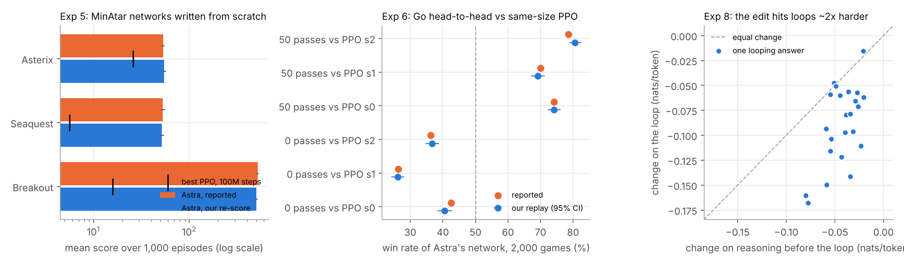
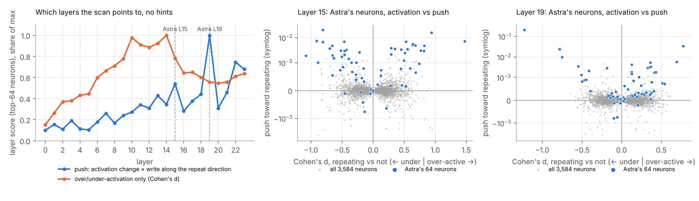
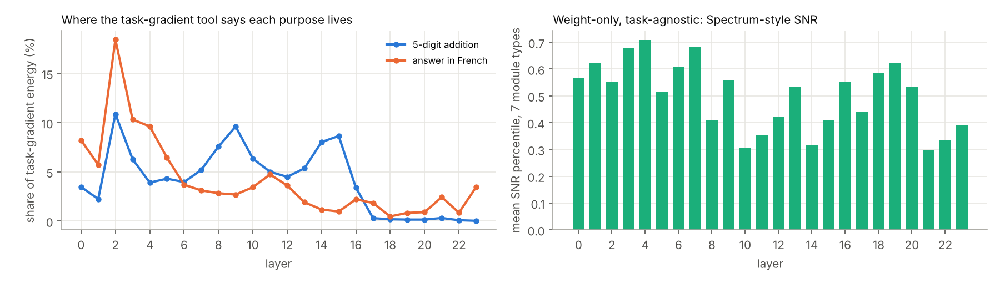
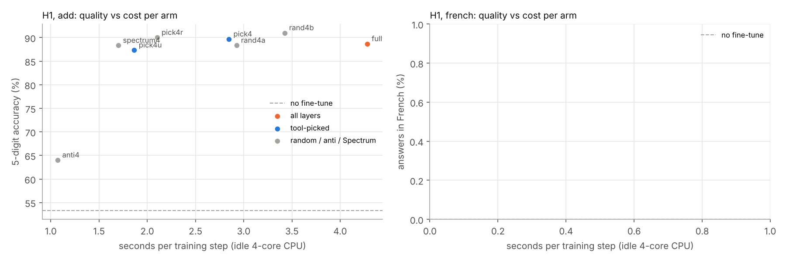

# Weight-space programming, checked on a CPU

This repo looks at the blog post
[Sparks of Weight-Space Programming](https://rikiyat.github.io/blog/weight-space-programming/)
(Takehi, Teoh, Zhang, Khattab, MIT CSAIL, Nov 2 2026). In the post, "GPT-6 Astra" reads and edits neural-network
weights directly. The repo asks three things:

1. **Do the post's claims hold up** when we re-run them with the authors' own released networks, edits and logs?
2. **H2.** Can ordinary tools (linear algebra, gradients, activation statistics, with no frontier LLM) read weight
   space the way Astra did?
3. **H1.** Can hand-picking *where* LoRA goes (layers or neurons, chosen by such tools for one purpose) cut the cost
   of fine-tuning without hurting, or while improving, the result?

Everything ran on 4-core x86 CPUs with no GPU (PyTorch 2.15, transformers 5.22, PEFT 0.21). The first host had
AMX-bf16; after a container restart the session moved to one without bf16 units (see *Precision* in §3).

## TL;DR

* **The blog's claims hold up wherever they can be re-run on a CPU.**
  * Astra's MinAtar networks (Exp 5) and Go networks (Exp 6) score what the post says, within 1.4 and 1.7 standard
    errors over 1,000 episodes and 2,000 games.
  * Its weight edits (Exps 4 and 8) rebuild bit for bit from the public weights.
  * The Qwen3.5-0.8B loop edit really does keep the model out of loops: restarted just before the point where the
    unedited model loops, repetition falls from 50.7% to 27.7% (14 / 16). It hits loop text about 2× harder than
    normal reasoning, but less cleanly than Astra's own probe claimed.
  * Two claims could not be re-run here: the MATH-500 jump (~60M generated tokens) and Kinetix (needs a JAX
    simulator).
* **H2 (read weight space with ordinary tools instead of a frontier LLM): mostly yes.**
  * Short deterministic scripts recover Astra's readings: 3 / 3 diffusion shapes, 2 / 3 networks' copying heads
    exactly, 3 / 4 games.
  * A mean-difference pipeline **rediscovers Astra's Exp 8 edit in 6 minutes of CPU**: the same direction (|cos|
    0.71 / 0.72), 39 / 64 and 29 / 64 of the same neurons (chance ≈ 1), and 77% of its loop selectivity. Astra took
    20 hours and ≥ 11M tokens.
  * The tools still needed someone to say what to look for, and they missed a few things Astra caught.
* **H1 (hand-pick layers or neurons for LoRA for a specific purpose): yes for cost and collateral damage, with a big
  caveat on how to pick.**
  * Four well-chosen layers match all-layer LoRA on the target with 6× fewer trainable weights, 1.6-2.7× less
    compute per step, and 2-12× less collateral damage.
  * Neuron-level picks (114,688 weights, Astra's footprint) match all-layer accuracy for addition, but picking
    high-gradient "hub" neurons also brings all-layer-sized side effects.
  * Placement is purpose-specific. The same cheap gradient tool that picked the best layers for addition (middle)
    picked the worst for "answer in French". There the last layers were best by far: 2.7× faster per step than
    all-layer LoRA, and they kept the most knowledge (capitals 89.6% vs 77.1%).


## 1. Do the blog's claims hold up?

Each claim was re-checked with the authors' own released artifacts (scripts in `verify/`, outputs in
`results/verify/`). Astra itself cannot be re-run, so the checks target what *can* be re-run: the networks it wrote,
the edits it made, the scoring, and the evidence it cited.

| Exp | Claim in the post | What we did | Result |
|---|---|---|---|
| 5 | MinAtar policies written from zero weights in one reply beat PPO-100M in all 3 games (517.4 / 53.1 / 53.2) | Rebuilt each network by parsing the `edits` block of Astra's reply; re-ran 1,000 fresh episodes per game in MinAtar 1.0.15 (sampled actions, sticky 0.1, 10k-step cap) | **Reproduced.** The rebuilt networks equal the released `hand.npz` bit for bit. Scores 502.9 ± 7.7 / 51.9 ± 1.4 / 54.7 ± 1.1 (all within 1.4 SE). PPO-100M best: 15.8 / 5.6 / 25.8. Note: 517 of 1,000 Breakout episodes hit the 10k-step cap, so that mean is capped. |
| 6 | 1.48M-weight Go net written from scratch: 0 passes 42.6 / 26.3 / 36.3%, 50 passes 74.2 / 70.0 / 78.5% vs same-size PPO | Replayed 2,000 games per pairing with pgx `go_9x9` and the released networks | **Reproduced.** 40.6 / 26.2 / 36.7% and 74.2 / 69.2 / 80.6%, every pairing within 1.7 SE. |
| 8 | Qwen3.5-0.8B fix = 131,072 weights (64 down_proj columns in layers 15 and 19) | Rebuilt all three runs' edits from the public weights with the release's `apply_edit.py` | **Reproduced.** Every base and edited SHA-256 matches. Each change is rank 1 (σ₁/σ₂ ≈ 1,500-1,800), 99.999% along one direction. One nuance: the direction's component in the 64 columns is multiplied by **−5** (W − 6·u·uᵀW), i.e. flipped and amplified, not only "subtracted". 131,072 is 0.017% of the 752M text-model weights. |
| 8 | The base model loops (93% of MATH-500 answers hit 32,768 tokens); after the edit most finish | Measured loops in the release's own first-sample generations | **Consistent.** 183 / 200 base answers contain a loop (≥ 90% of 300 consecutive 8-word n-grams seen before; median onset 2,725 words) vs 72 / 200 after the 50-pass edit (median onset 7,856 words); 13 vs 152 close `</think>`. The 10- and 25-pass edits barely help (166 and 169 loop), as the post says. |
| 8 | The edit removes the loop direction selectively, leaving productive reasoning alone (Astra's probe: −0.103 vs −0.009 nats/token) | Teacher-forced log-probs on 24 of the base model's own looping MATH-500 answers, which Astra never saw: 768 tokens before the loop vs 768 tokens of it | **Partly.** Loop text −0.089 ± 0.008 nats/token, the reasoning just before it −0.042 ± 0.003; loop hit harder in 22 / 24. It is selective, but productive text moves 4-5× more than Astra's probe said. |
| 8 | MATH-500 7.9% → 48.1% at 32,768 thinking tokens | Not re-run: ~60M generated tokens at ~28 tok/s on this CPU. Instead, a loop-entry test (below): restart the base model's looping answers just before the loop, with and without the edit. | **Consistent (mechanism only).** The edit cuts repetition after the restart point from 50.7% to 27.7% (14 / 16 answers). The benchmark gains themselves are not re-measured. |
| 2 | Names the shape each DDPM draws (3 / 3); the models draw filled shapes while Astra drew outlines | Re-sampled 1,000 images per model with the release's schedule; parsed Astra's drawings | **Reproduced.** Samples are filled (interior share 0.32-0.50; an outline is ~0); Astra's drawings have interior 0.0. Our crude classifier sorts samples into the right class 94 / 92 / 74% of the time (its accuracy on genuine shapes: 84 / 100 / 69%). |
| 3 | From the middle 4 blocks only, names the language 6 / 6 and finds every copying head | Checked Astra's answers against the release's measured `heads.json`; tested Astra's stated evidence | **Consistent.** Answers match ground truth. Python has 3 copying heads vs 1 for the others, and romaji's last block does write in fewer directions (effective rank of W_o.3: 151 vs 184 / 157), as Astra argued. |
| 1 | Names the game of 4 / 4 PPO policies from 17,253 raw weights | Checked answers against the key; examined the evidence Astra cited | **Consistent.** The agent-channel weights really do sit on Breakout's bottom row, in Pong's edge column and on Pac-Man's maze (see H2). |
| 4 | One-shot edit of 3.5% of a Kinetix car policy: 0% → 100% success | Applied Astra's 51 edit statements to the network as shown (rounded) | **Partly.** The rebuilt network equals the released one bit for bit; 6,073 / 171,664 weights (3.54%) change. Success rates need the Kinetix JAX simulator and were not re-run. |
| 7 | Weights alone: cannot pick the sycophantic Gemma fine-tune; with attention patterns: 3 / 3 | Re-scored the released predictions against the answer key (fine-tuned models are not released, 17 GB) | **Consistent.** Attention tool 3 / 3. Each weights-only run answered "A" for every pair at p = 0.5, i.e. chance (1 / 3). |

**Exp 8 loop-entry test** (`verify/exp8_qwen35_edit.py`, stage 4). A full MATH-500 re-run is out of reach on a CPU,
so we restarted 16 of the base model's own looping answers 256 tokens before the loop begins. Both models then
sampled 384 tokens with the blog's settings (temperature 0.6, top-p 0.95, top-k 20, presence penalty 1.5), and we
measured how much of the continuation repeats 12-grams already in the context:

| | share of the continuation that repeats earlier text | continuations that are mostly repetition (> 50%) |
|---|---|---|
| base Qwen3.5-0.8B | 50.7% | 8 / 16 |
| with Astra's 131,072-weight edit | **27.7%** | **1 / 16** |

The paired difference is −23.0 ± 5.5 points, and the edited model repeats less in 14 / 16 restarts. Independently of
the blog's own evaluation, the edit really does keep the model from walking into the loop at the point where the
unedited model does.



## 2. H2: can ordinary tools read weight space instead of a frontier LLM?

For each reading Astra made, we wrote the most standard tool we could think of, with no LLM in the loop, and scored
it against the same ground truth.

| Exp | Astra (frontier LLM reading raw weights) | Ordinary tool, no LLM | Tool result |
|---|---|---|---|
| 2 | Shape of 3 / 3 diffusion models, no forward pass | Edge-orientation profile (Sobel, magnitude-weighted) of the 64 output-layer "strokes" in W3, matched to templates from synthetic shapes (`verify/exp2_diffusion.py`) | **3 / 3.** Correlation with the right template: circle 0.18, square 0.57, triangle 0.46; every wrong template ≤ 0.14. |
| 3 | Copying heads from the middle blocks only, 3 / 3 networks exact | Elhage et al. (2021) composition on the blocks: LayerNorm folded into Q/K/V/O (gain, and mean-removal as a projection), then the signed K-composition tr(QK·OV) with every earlier head (`verify/exp3_heads.py`) | **2 / 3 exact.** Python {3.5, 3.1, 2.1} and English {3.1} are found exactly; for romaji the true head 3.3 is ranked 2nd (0.063 vs 0.067). The textbook unsigned Frobenius score without the LayerNorm fold failed completely (true copying heads ranked last). We chose the signed variant after seeing that failure, and Astra used the same idea. |
| 1 | Game of 4 / 4 PPO policies, open answer | Where the agent channel's first-layer weights are large, plus which actions the output layer separates, through a fixed 3-rule decision (`verify/exp1_readout.py`) | **3 / 4.** Breakout (bottom row, left/right), Pong (edge column, up/down) and Pac-Man (maze-shaped map, all moves) are right. Freeway is missed: this variant lets the agent move sideways too. The tool also knew the four genres, which Astra was not told. |
| 8 | Found the loop direction and 64 writer neurons in 2 layers (158 turns, 20 h, 50 forward passes) | Mean-difference direction between loop and pre-loop activations, then writer-neuron ranking (`experiments/h2_rediscover_loop_edit.py`) | see below |

**What the frontier-LLM route cost.** Token counts are summed from the release's `run.json` files
(`results/verify/astra_usage.json`). Exps 3 and 8 count only the largest cumulative value per run folder, so they are
lower bounds.

| Exp | Astra: input / output tokens, turns | Our tool: CPU time |
|---|---|---|
| 1 | 295k / 7k, 4 turns | < 1 s |
| 2 | 299k / 7.5k, 3 turns | ~1 s for the reading; the 3,000 DDPM samples used only to check it take ~2 min |
| 3 | ≥ 1.6M / 116k, 54 turns | ~20 s |
| 8 | ≥ 11.4M / 335k, 562 turns (with the Gemma follow-up), plus 85 forward passes | see below |

### Exp 8 without an LLM: a scripted rediscovery of Astra's loop edit

`experiments/h2_rediscover_loop_edit.py` runs, as plain code, the recipe Astra's own final report describes. It uses
inputs Astra never saw, and problems disjoint from the ones the edits are tested on:

1. **Direction.** u = unit(mean residual after layer 15 / 19 on loop tokens − mean on the 768 tokens before the
   loop), taken over 16 of the base model's looping MATH-500 answers.
2. **Neurons.** Each neuron's push along u is E[activation] × (u · W_down[:, j]). Keep the 64 whose push grows most
   from pre-loop text to loop text.
3. **Edit.** W' = W − 6·u·(mask ⊙ uᵀW), the same formula and strength as Astra's final edit.
4. **Test.** On 12 *other* looping answers, compare teacher-forced log-probs of the reasoning before the loop and of
   the loop itself. Arms: base, Astra's edit, the tool's edit, and a random edit with the same Frobenius norm
   (random unit direction, random 64 columns).

| | Astra (158 turns, ~20 h, 50 forward passes) | Tool pipeline (no LLM) |
|---|---|---|
| Time to find the edit | ~20 hours | **5-6 min of CPU** (16 forward passes) |
| Direction, layer 15 / 19 | – | \|cos\| with Astra's direction **0.71 / 0.72** (two random directions in 1,024 dims: ~0.03) |
| The 64 neurons, layer 15 / 19 | – | **39 / 64 and 29 / 64** are the same neurons Astra picked (chance: ~1) |

Teacher-forced change in log-probability on held-out looping answers (nats/token; first run, 10 of 12 answers before a
container restart, `results/h2/rediscover_loop_edit_run1_partial.json`):

| Edit | Reasoning before the loop | Loop text | Selectivity (loop − reasoning) |
|---|---|---|---|
| Astra's | −0.042 | −0.086 | −0.044 ± 0.012 |
| Tool's | −0.031 | −0.065 | −0.034 ± 0.010 |
| Random, same size | +0.000 | −0.000 | −0.000 ± 0.000 |

The container then moved to a CPU without bf16 units, so the full run was repeated in float32, re-scoring base and
Astra in the same precision (`results/h2/rediscover_loop_edit.json`). It finds the same direction and the same neurons
to the digit, and matches the first run's 10 answers to within 0.001 nats/token. All 12 held-out answers:

| Edit | Reasoning before the loop | Loop text | Selectivity (loop − reasoning) |
|---|---|---|---|
| Astra's | −0.039 | −0.082 | −0.042 ± 0.010 |
| **Tool's** | −0.028 | −0.061 | **−0.033 ± 0.008** |
| Random, same size | −0.000 | −0.000 | +0.000 ± 0.000 |

The tool's edit hits the loop harder than the reasoning on 11 / 12 answers, and reaches ~75% of Astra's loop
suppression and ~77% of its selectivity. A random edit of the same size does nothing. The pipeline took 368 s on 4
cores, against Astra's 158 turns, ≥ 11M tokens and 50 forward passes.

### Finding the loop neurons blind: a one-pass neuron scan

The rediscovery above was *told* to look at layers 15 and 19. Astra's 20 hours went mostly into the search, so the real
question is whether the search can be cheap too. `wsp/neuron_scan.py` benchmarks every MLP neuron of a model under
two conditions in one forward pass per text, and `experiments/h2_blind_neuron_scan.py` runs it with no hint about
layers or neurons:

1. **Labels.** 16 of the base model's looping answers (disjoint from the 12 test answers). Each of the 768 tokens
   before and after the loop starts is labelled *repeating* if the 12 tokens ending there already appeared earlier in
   the answer (16,406 tokens), otherwise *not repeating* (8,170 tokens).
2. **Scan.** Hooks on all 24 `down_proj` inputs keep running sums, so all 24 × 3,584 = 86,016 neurons are scored in
   16 forward passes: **6-7 minutes on 4 CPU cores** (440 s and 378 s in two runs), with flat memory.
3. **Two ways to score a neuron.**
   * *Over/under-activation*: Cohen's d of its activation, repeating vs not. This is the plain benchmark.
   * *Push*: its change in activation × (u · W_down[:, j]), where u is the unit direction from the mean
     non-repeating residual to the mean repeating residual after that layer. This measures how far the neuron's
     change in activity moves the residual stream toward "repeating". A neuron that goes *quiet* during repeats also
     pushes toward repeating if it normally writes against u.

   A layer's score is the sum of its 64 largest |scores|.



| | Over/under-activation (Cohen's d) | Push |
|---|---|---|
| Top 6 layers | 14, 10, 13, 11, 12, 15 | **19**, 22, 23, **15**, 21, 18 |
| Median rank of Astra's layer-15 neurons among all 86,016 | top 72% (signed d), top 4.0% (\|d\|) | **top 0.46%** |
| Median rank of Astra's layer-19 neurons among all 86,016 | top 39% (signed d), top 27% (\|d\|) | **top 2.2%** |
| Overlap with the scan's top 64 in that layer (L15 / L19) | 19 / 11 (\|d\|) | **38 / 29** (chance: ~1) |

So there *is* a pattern, and it is not brute force. But plain over- or under-activation is not quite it:

* Activation alone points at the middle layers (10-14), where the model's activity changes the most overall.
* Astra's neurons split about evenly: 56% / 44% (L15 / L19) get *less* active while the model repeats. 30 of the 36
  quieter layer-15 neurons still push toward repeating, because they normally write against the repeat direction.
* What singles Astra's neurons out is the product of the two: the activation change times the direction the neuron
  writes in. 89-91% of them have positive push.
* Ranked by push, the scan puts Astra's layer 19 first and layer 15 fourth, with no hints, in 6-7 CPU-minutes.

**Does the scan's own edit work?** We edited the scan's top-2 layers by push (19 and 22), top-64 push neurons each,
with Astra's formula. The test used the same 12 held-out answers and float32 scoring as above. Arms: the activation-only
pipeline (layers 10 and 14, top-64 by d) and a random edit of the same size.

| Edit | Reasoning before the loop | Loop text | Selectivity | Loop hit harder |
|---|---|---|---|---|
| Astra's (15 + 19) | −0.039 | −0.082 | −0.042 ± 0.010 | 10 / 12 |
| Scan, push (19 + 22) | −0.011 | −0.029 | −0.018 ± 0.003 | 11 / 12 |
| Scan, activation only (10 + 14) | −0.000 | −0.001 | −0.001 ± 0.000 | 8 / 12 |
| Random, same size | +0.000 | +0.000 | +0.000 ± 0.000 | 3 / 12 |

The push pipeline's edit works: it is cleaner than Astra's on the reasoning (−0.011 vs −0.039), but reaches only 44%
of its selectivity. The activation-only edit does nothing.

**Adding one cheap causal check finds Astra's exact layers** (`experiments/h2_scan_then_screen.py`). The push score says
which neurons push toward repeating, not whether removing that push helps. So: take the scan's top-6 layers, edit each
one *alone*, and score it on 4 of the scan's own answers (never the 12 test answers). That is 6 candidate edits, not a
search over 86,016 neurons.

| Layer (scan rank) | 19 (1) | 22 (2) | 23 (3) | 15 (4) | 21 (5) | 18 (6) |
|---|---|---|---|---|---|---|
| Selectivity, edited alone, 4 scan answers | **−0.028** | −0.004 | +0.022 | **−0.021** | −0.004 | −0.003 |

Layer 23 hurts reasoning more than loops, and 22, 21 and 18 barely matter. The two kept are **15 and 19, Astra's
layers, found without hints**, and their top-64 push neurons include 38 / 64 and 29 / 64 of Astra's. On the 12 held-out
answers:

| Edit | Reasoning before the loop | Loop text | Selectivity | Loop hit harder |
|---|---|---|---|---|
| Astra's (15 + 19) | −0.039 | −0.082 | −0.042 ± 0.010 | 10 / 12 |
| Hinted tool (told 15 + 19, window labels; above) | −0.028 | −0.061 | −0.033 ± 0.008 | 11 / 12 |
| **Scan + screen (blind, 15 + 19)** | −0.026 | −0.047 | **−0.021 ± 0.006** | 9 / 12 |
| Random, same size, same layers | −0.000 | −0.000 | +0.000 ± 0.000 | 6 / 12 |

Total discovery cost: **6.3 CPU-minutes of scan + 11.4 of screen**, with no LLM and no hint. Astra took 20 hours and
≥ 11M tokens.

The blind edit uses the same layers as the hinted tool, almost the same direction (|cos| 0.98 in both layers) and
almost the same neurons (59 / 64 and 51 / 64 shared). It costs the reasoning the same on every answer, but its loop
effect is ~20% weaker. The 18 neurons that differ come from the labels. The scan calls a token "repeating" if its
12-gram occurred earlier. The hinted tool contrasts the 768 tokens after the loop starts with the 768 before, which is
exactly what the test scores.

<!-- WINDOW -->

**H2 verdict.** Yes, with caveats. For every reading we tried, a few dozen lines of ordinary linear algebra or
activation statistics recover most of what Astra read, in seconds to minutes of CPU instead of hundreds of thousands to
millions of frontier-model tokens. The tools needed knowing *what to look for*: the purpose, a contrast set, a recipe.
They missed some things Astra caught (Freeway, the romaji head), and one textbook score failed outright. That is the
real division of labour: a cheap model or a person picks the question and the recipe, and tools do the reading.

## 3. H1: does hand-picking where LoRA goes cut cost and keep (or improve) quality?

**Setup** (`experiments/h1_*.py`, `wsp/train.py`). Model: Qwen2.5-0.5B-Instruct, frozen in bfloat16, adapters in
float32. Every arm uses the same data, steps, batch and learning rate (LoRA 1e-3, neuron deltas 3e-4). Purposes:

* **add**: 5-digit + 5-digit addition with the answer only (base model: 53.3% with plain greedy decoding). 3,000 training sums, 150 steps of
  16. Scored on 300 held-out sums, plus 200 6-digit sums, a length never trained on.
* **french**: answer English questions in French by default. The training data is context distillation from the model
  itself: the teacher sees "...\nAnswer in French only." and the student does not. Scored as the share of 96 held-out
  answers in French, and on 48 capital-city questions answered correctly.

Collateral damage: KL(base ‖ tuned) on raw Wikipedia text and on generic chat replies, and 0-shot MMLU on a fixed 200
questions.

**Where the tools put the adapters** (`experiments/h1_locate.py`). Before any training, one backward pass of the task
loss on 64 examples gives the gradient energy of every linear module. The cost is about one minute of CPU, with no
LLM.

| Arm | Trainable weights |
|---|---|
| `full` | LoRA r=8 on q, k, v, o, gate, up and down of all 24 layers (the usual default) |
| `pick4` | LoRA r=8 on the 4 layers with the most task-gradient energy |
| `pick4r` | the 4 layers with the highest ratio of task to generic gradient energy (generic = language-modelling loss on WikiText). This divides out the depth profile every loss shares (`results/h1/generic_grad.json`) |
| `pick4u` | the 4 upper-half layers with the most energy: a cost-aware pick, since backprop stops and the frozen-layer cache starts at the lowest trainable layer |
| `spectrum4` | the 4 layers with the highest weight-only SNR (Spectrum-style: singular values above the Marchenko-Pastur edge), so not task-specific |
| `rand4a`, `rand4b`, `anti4`, `arb4` | controls: two random draws, the 4 layers with the *least* energy, and layers 12, 21, 22, 23 (picked arbitrarily by a NaN bug in our first Spectrum score) |
| `neur` | only the down_proj columns of the 64 neurons with the most gradient energy in each of the 2 MLPs with the most energy: 114,688 weights, the footprint of Astra's Exp 8 edit |
| `neur_rand` | 64 random neurons in the same 2 layers |

A rank-1 all-layer arm (`full_r1`) was planned but did not finish before the host change, so it is not reported.



Two cost savers come for free once the trainable weights sit at layer L and above. Autograd never backpropagates below
L. And the hidden states entering L never change, so they are computed once per example (frozen-prefix cache)
instead of once per step.

**Precision.** The addition layer arms ran in bfloat16 on the original AMX host. After a container restart the session
moved to a CPU without bf16 units, where bfloat16 is 4.3× slower than float32, so the neuron arms and every French arm
ran in float32. Comparisons are made within one precision: layer arms vs layer arms, neuron arm vs neuron arm, French vs
French. The bf16 and float32 base models score within 1.5 points of each other on MMLU-200.

### Results: addition (base 53.3%, 6-digit 20.0%)

| arm | layers | 5-digit | 6-digit (unseen) | KL Wikipedia | KL chat | MMLU-200 | final train loss | trainable weights | precision |
|---|---|---|---|---|---|---|---|---|---|
| no fine-tune | - | 53.3% | 20.0% | 0.0000 | 0.0000 | 43.5% | - | - | bfloat16 |
| LoRA, all 24 layers | all | 88.7% | 80.5% | 0.1588 | 0.4428 | 34.5% | 0.043 | 4,399,104 | bfloat16 |
| LoRA, 4 layers: task-gradient tool | 2, 9, 14, 15 | 89.7% | 87.0% | 0.0338 | 0.0663 | 39.0% | 0.036 | 733,184 | bfloat16 |
| LoRA, 4 layers: task / generic gradient | 9, 13, 14, 15 | 90.0% | 83.5% | 0.0129 | 0.0433 | 41.5% | 0.047 | 733,184 | bfloat16 |
| LoRA, 4 layers: tool, upper half only | 12, 13, 14, 15 | 87.3% | 83.5% | 0.0162 | 0.0462 | 35.0% | 0.045 | 733,184 | bfloat16 |
| LoRA, 4 layers: Spectrum SNR (weights only) | 1, 3, 4, 7 | 90.0% | 89.5% | 0.0685 | 0.1646 | 39.5% | 0.036 | 733,184 | float32 |
| LoRA, 4 arbitrary layers | 12, 21, 22, 23 | 88.3% | 78.5% | 0.0250 | 0.0649 | 41.5% | 0.045 | 733,184 | bfloat16 |
| LoRA, 4 random layers (a) | 4, 10, 12, 20 | 88.3% | 87.5% | 0.0523 | 0.1521 | 40.0% | 0.039 | 733,184 | bfloat16 |
| LoRA, 4 random layers (b) | 1, 2, 3, 17 | 91.0% | 88.5% | 0.1129 | 0.1054 | 42.5% | 0.033 | 733,184 | bfloat16 |
| LoRA, 4 layers the tool ranks lowest | 19, 20, 22, 23 | 64.0% | 31.0% | 0.0198 | 0.0125 | 42.5% | 0.195 | 733,184 | bfloat16 |
| 64 + 64 neurons: task-gradient tool | 2, 3 | 91.0% | 86.5% | 0.1777 | 0.1476 | 41.5% | 0.040 | 114,688 | float32 |
| 64 + 64 random neurons | 2, 3 | 81.7% | 67.0% | 0.0004 | 0.0136 | 45.0% | 0.093 | 114,688 | float32 |

* **Placement decides whether the skill is learned at all.** On the 4 layers the tool ranks lowest (19, 20, 22, 23),
  LoRA reaches only 64.0%, with training loss stuck at 0.195. Every 4-layer placement that touches the middle of the
  network reaches 87-91% (loss ≈ 0.04).
* **Four well-placed layers match all 24.** The tool picks score 89.7-90.0% on 5-digit sums vs 88.7% for all-layer
  LoRA, and do better on the unseen 6-digit length (83.5-87.0% vs 80.5%), with 6× fewer trainable weights.
* **The tool's picks do the least collateral damage** among the arms that learn the task. The relative pick's KL on
  Wikipedia is 0.013 vs 0.159 for all-layer LoRA (12× less) and 0.052-0.113 for random 4-layer placements. KL on chat
  replies is 0.043 vs 0.443, and MMLU-200 is 41.5% vs 34.5% (base 43.5%).
* **Weight-only picks work, but are not the cleanest.** The Spectrum SNR pick (1, 3, 4, 7) learns the task (90.0% /
  89.5%, the best unseen-length score) with 5× the relative tool pick's KL on Wikipedia (0.069). An earlier version of
  our Spectrum score had a NaN bug and picked layers 12, 21, 22, 23 arbitrarily; that run is kept as the
  "4 arbitrary layers" control.
* **Neurons.** Training only the down_proj columns of 64 + 64 tool-picked neurons (114,688 weights, Astra's footprint,
  38× fewer than all-layer LoRA) reaches 91.0% / 86.5%, as good as any arm. 64 + 64 random neurons in the same two
  layers reach 81.7% / 67.0%. But the tool's neurons sit in layers 2-3, which carry most of the gradient for *any* loss.
  They are hub neurons, and moving them moves everything: KL on Wikipedia 0.178 vs 0.0004 for the random neurons.

### Results: answer in French (base: 0% French, capitals 100%, MMLU-200 42.0%)

| arm | layers | in French | capitals right | KL Wikipedia | MMLU-200 | final train loss | trainable weights | precision |
|---|---|---|---|---|---|---|---|---|
| no fine-tune | - | 0.0% | 100.0% | 0.0000 | 42.0% | - | - | float32 |
| LoRA, all 24 layers | all | 100.0% | 77.1% | 0.1962 | 38.5% | 0.301 | 4,399,104 | float32 |
| LoRA, 4 layers: task-gradient tool | 0, 2, 3, 4 | 97.9% | 75.0% | 0.4596 | 27.5% | 1.071 | 733,184 | float32 |
| LoRA, 4 layers: task / generic gradient | 5, 10, 11, 12 | 99.0% | 52.1% | 0.0398 | 34.5% | 0.678 | 733,184 | float32 |
| LoRA, 4 layers: Spectrum SNR (weights only) | 1, 3, 4, 7 | 99.0% | 43.8% | 0.2527 | 40.5% | 0.731 | 733,184 | float32 |
| LoRA, 4 random layers (a) | 4, 10, 12, 20 | 99.0% | 54.2% | 0.0607 | 37.0% | 0.596 | 733,184 | float32 |
| LoRA, 4 layers the tool ranks lowest | 18, 19, 20, 22 | 100.0% | 89.6% | 0.0995 | 44.0% | 0.535 | 733,184 | float32 |

* **The target cannot tell placements apart; the side effects can.** Every placement makes the model answer in French
  (98-100%). Knowledge survives very differently: capitals 43.8-89.6%, MMLU-200 27.5-44.0%.
* **The last layers are by far the best place.** Layers 18, 19, 20, 22 give 100% French, capitals 89.6%, MMLU 44.0%
  (base 42.0%) and the lowest training loss of all French arms (0.54).
* **The task-gradient tool got this purpose backwards.** Its top layers (0, 2, 3, 4) are the worst (MMLU 27.5%, KL
  0.46); the 4 it ranks lowest are the best. The relative variant (middle layers, capitals 52%) and the weight-only
  Spectrum pick (early layers, capitals 44%) do no better.

### Cost: clean benchmark (`experiments/h1_cost.py`, `results/h1/cost.json`)

Every arm was timed alone, one after another, on the same idle 4-core CPU, in float32 (the post-restart host): 3
warm-up steps, then the median of 8 timed training steps on identical batches. "Est. full run" = one-off prefix cache
for all training examples + seconds per step × the sweep's step count.

**Addition**

| arm | backprop stops at layer | trainable weights | Adam state (MB) | s / step | vs all-layer | one-off prefix cache (s) | est. full run (s) | peak RSS (MB) |
|---|---|---|---|---|---|---|---|---|
| LoRA, all 24 layers | 0 | 4,399,104 | 33.6 | 4.84 | - | 0 | 725 | 6819 |
| LoRA, 4 layers: task-gradient tool | 2 | 733,184 | 5.6 | 4.16 | 1.2x faster | 43 | 666 | 5470 |
| LoRA, 4 layers: task / generic gradient | 9 | 733,184 | 5.6 | 3.03 | 1.6x faster | 165 | 620 | 4536 |
| LoRA, 4 layers: tool, upper half only | 12 | 733,184 | 5.6 | 2.26 | 2.1x faster | 215 | 554 | 4226 |
| LoRA, 4 layers: Spectrum SNR (weights only) | 1 | 733,184 | 5.6 | 4.12 | 1.2x faster | 18 | 635 | 5514 |
| LoRA, 4 arbitrary layers | 12 | 733,184 | 5.6 | 2.33 | 2.1x faster | 215 | 565 | 4347 |
| LoRA, 4 random layers (a) | 4 | 733,184 | 5.6 | 3.70 | 1.3x faster | 75 | 630 | 5221 |
| LoRA, 4 random layers (b) | 1 | 733,184 | 5.6 | 3.96 | 1.2x faster | 18 | 612 | 5413 |
| LoRA, 4 layers the tool ranks lowest | 19 | 733,184 | 5.6 | 1.10 | 4.4x faster | 334 | 499 | 3429 |
| 64 + 64 neurons: task-gradient tool | 2 | 114,688 | 0.9 | 3.71 | 1.3x faster | 38 | 595 | 5073 |
| 64 + 64 random neurons | 2 | 114,688 | 0.9 | 3.57 | 1.4x faster | 33 | 568 | 5144 |

**French**

| arm | backprop stops at layer | trainable weights | Adam state (MB) | s / step | vs all-layer | one-off prefix cache (s) | est. full run (s) | peak RSS (MB) |
|---|---|---|---|---|---|---|---|---|
| LoRA, all 24 layers | 0 | 4,399,104 | 33.6 | 5.09 | - | 0 | 611 | 7388 |
| LoRA, 4 layers: task-gradient tool | 0 | 733,184 | 5.6 | 4.75 | 1.1x faster | 0 | 570 | 5959 |
| LoRA, 4 layers: task / generic gradient | 5 | 733,184 | 5.6 | 3.93 | 1.3x faster | 26 | 498 | 5713 |
| LoRA, 4 layers: tool, upper half only | 12 | 733,184 | 5.6 | 2.92 | 1.7x faster | 62 | 412 | 4791 |
| LoRA, 4 layers: Spectrum SNR (weights only) | 1 | 733,184 | 5.6 | 4.70 | 1.1x faster | 6 | 570 | 5955 |
| LoRA, 4 random layers (a) | 4 | 733,184 | 5.6 | 4.13 | 1.2x faster | 22 | 517 | 5710 |
| LoRA, 4 layers the tool ranks lowest | 18 | 733,184 | 5.6 | 1.91 | 2.7x faster | 93 | 323 | 4180 |

* **What saves compute is how high the lowest trainable layer sits, not how few weights train.** Backprop stops at the
  lowest trainable layer, so 4 layers starting at layer 0-2 save only 10-20% per step, while 4 layers starting at
  layer 12 save 2×, and at layer 18-19, 2.7-4.4×. The neuron arms train 38× fewer weights than all-layer LoRA, yet
  per step they save only as much as their lowest layer (2) allows.
* **Memory and optimizer state shrink with the trainable set.** Adam state drops from 33.6 MB to 5.6 MB (4 layers) or
  0.9 MB (neurons), and peak memory drops by up to 43% (7.4 → 4.2 GB for French).
* **The frozen-prefix cache pays off only across epochs.** For addition (2,400 example-visits over 3,000 examples)
  caching every example costs more than it saves: end-to-end gains are 1.1-1.5×. For French (2 epochs) the late-layer
  arm finishes in 323 s vs 611 s (1.9× faster).
* **For French, the best placement is also nearly the cheapest:** the last 4 layers are 2.7× faster per step, use 43%
  less memory, and give the best retention (capitals 89.6% vs 77.1%, MMLU 44.0% vs 38.5%). For addition, the
  lowest-damage tool pick (task / generic gradient) is 1.6× faster per step at the same accuracy and 12× less KL.



### H1 verdict

**Partly yes.** *Where* the trainable weights go was one of the largest effects we measured. It decided whether
addition was learned at all (64% vs 90%). At equal accuracy it changed collateral damage by 10× or more. And it
cut trainable weights 6× (four layers) to 38× (neurons), and compute per step (cost table above).

**But a cheap tool is not enough to do the picking.** The same task-gradient tool that found the best placements for
addition picked the worst ones for French. Gradient energy in this model is dominated by layers 2, 3 and 21 for any
loss (massive activations; Sun et al. 2024). Adam also rescales every parameter's step, so raw gradient size is a poor
guide to where training is effective.

What held across both purposes is a coarse rule: computation (addition) is learned in the middle of the network,
output style (language) at the top. A practical recipe consistent with these runs: start with the top layers, which
are the cheapest because backprop stops there, and watch the training loss for a few dozen steps. Move down only if it
stalls, as it did for addition (0.195 vs 0.04). This recipe was not tested as a procedure of its own.

## Related work

Links checked by a Haiku scout agent; the claims are from each paper's abstract or README.

| Work | What it says about where to fine-tune / reading weights without an LLM |
|---|---|
| [Spectrum](https://arxiv.org/abs/2406.06623) ([code](https://github.com/QuixiAI/spectrum)), Hartford et al. 2024 | Scores each module's signal-to-noise ratio, splitting singular values at the Marchenko-Pastur edge, and trains only the top modules. Our `spectrum4` arm is a re-implementation. |
| [LISA](https://arxiv.org/abs/2403.17919), Pan et al., NeurIPS 2024 | Randomly freezes most middle layers during training, motivated by skewed per-layer weight norms under LoRA. |
| [Surgical fine-tuning](https://arxiv.org/abs/2210.11466) ([code](https://github.com/anniesch/surgical-finetuning)), Lee et al., ICLR 2023 | Which layers are worth tuning depends on the kind of shift. Our two purposes show the same thing. |
| [S2FT](https://arxiv.org/abs/2412.06289) ([code](https://github.com/Infini-AI-Lab/S2FT)), Yang et al. 2024 | Fine-tunes only a few attention heads and FFN channels per block; the neuron-level counterpart of our `neur` arm. |
| [ReFT / LoReFT](https://arxiv.org/abs/2404.03592) ([code](https://github.com/stanfordnlp/pyreft)), Wu et al. 2024 | Trains low-rank interventions on hidden states at chosen layers instead of weights. |
| [Does Localization Inform Editing?](https://arxiv.org/abs/2301.04213), Hase et al., NeurIPS 2023 | Counterpoint: causal-tracing localization did not predict the best layer to edit for stored facts. |
| [Refusal is mediated by a single direction](https://arxiv.org/abs/2406.11717), Arditi et al. 2024 | Difference-of-means direction plus weight orthogonalisation, the same recipe Astra's Exp 8 edit and our rediscovery use. |
| [A Mathematical Framework for Transformer Circuits](https://transformer-circuits.pub/2021/framework/index.html), Elhage et al. 2021 | QK / OV circuits and composition scores, the basis of our Exp 3 tool. |
| [Massive Activations](https://arxiv.org/abs/2402.17762), Sun et al., COLM 2024 | A few fixed dimensions carry activations ~10⁵× larger than the rest. This is the likely reason layers 2, 3 and 21 of Qwen2.5-0.5B carry most of the gradient energy for any loss (§3). |
| [WeightWatcher](https://github.com/CalculatedContent/WeightWatcher), Martin & Mahoney | Power-law fits of each layer's eigenvalue spectrum as a training-free, data-free diagnostic. |

## Repository layout

| Path | What it is |
|---|---|
| `third_party/lm_understand-logs/` | The blog's released logs ([RikiyaT/lm_understand-logs](https://github.com/RikiyaT/lm_understand-logs) @ `4d09ba6`, MIT / CC BY 4.0): every script, README, evaluation JSON and small network (7 MB). `third_party/fetch_lm_understand_logs.sh` fetches the full 370 MB (Exp 3's blocks, Exp 6's networks, Exp 8's generations) into `third_party/lm_understand-logs-full/`. |
| `verify/` | One script per blog experiment that re-checks its claims. |
| `experiments/h2_rediscover_loop_edit.py` | H2: a scripted pipeline that tries to rediscover Astra's Qwen3.5-0.8B loop edit. |
| `wsp/neuron_scan.py`, `experiments/h2_blind_neuron_scan.py`, `h2_scan_then_screen.py`, `h2_scan_ablate.py` | H2, blind: a one-pass scan of every MLP neuron (over/under-activation and push), a 6-candidate causal screen, and the layer-vs-neuron ablation. |
| `experiments/h1_*.py`, `experiments/h1_sweep.sh` | H1: tool-based placement and LoRA arms on Qwen2.5-0.5B-Instruct. |
| `wsp/` | Shared code: model helpers, tasks and retention probes (`tasks.py`), placement tools (`locate.py`), LoRA and neuron-sparse training with cost accounting (`train.py`). |
| `results/` | Every number in this README, as JSON (`verify/`, `h1/`, `h2/`). |

## Reproduce

```bash
uv venv venv --python 3.13 && source venv/bin/activate
uv pip install -r requirements.txt minatar==1.0.15 "jax[cpu]" pgx
third_party/fetch_lm_understand_logs.sh          # large files for Exp 3, 6, 8
```

```bash
python verify/exp5_minatar.py            # ~3 min
python verify/exp2_diffusion.py          # ~3 min
python verify/exp3_heads.py              # ~1 min
python verify/exp1_readout.py; python verify/exp4_footprint.py
python verify/exp6_go_h2h.py             # ~5 min
python third_party/lm_understand-logs/exp8_math/code/apply_edit.py <Qwen3.5-0.8B model.safetensors> third_party/lm_understand-logs-full/exp8_math/runs/p50c/edit /home/user/edits/p50c
python verify/exp8_qwen35_edit.py        # ~60 min on CPU
python experiments/h2_rediscover_loop_edit.py
python experiments/h2_blind_neuron_scan.py      # ~30 min: scan all 86,016 neurons, no hints
python experiments/h2_scan_then_screen.py       # ~30 min: scan + 6-candidate screen (--labels window for the window-label variant)
python experiments/h2_scan_ablate.py            # ~15 min: |d| vs push neurons, reuses the saved scan
python verify/exp8_released_generations.py
python experiments/h1_locate.py --purpose add && python experiments/h1_locate.py --purpose french
experiments/h1_sweep.sh                  # bf16; on a CPU without AMX use: H1_DTYPE=float32 experiments/h1_sweep.sh
python experiments/h1_cost.py --dtype float32 --steps 8   # clean per-step cost, run on an otherwise idle machine
python experiments/h1_report.py && python experiments/make_figures.py
```

The arms that ran after the host change used `experiments/h1_fp32_queue.sh`, which keeps two float32 runs under the
session's ~15 GB memory limit.
